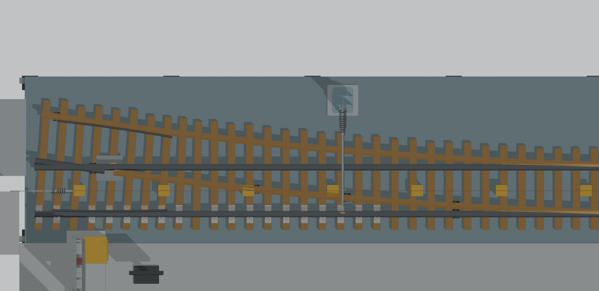

# GTSD 来源整机与虚拟研究控制台

## 交付状态：资源已齐备，真实远端验收通过

当前公开分支已具备完整恢复和软件运行所需资源：原有 57 项运行资产、432 份新增来源 JSON 均可从仓库分块校验恢复，来源目录共 476 条审阅状态。真实远端 fresh checkout 已通过运行验收，证据见 [remote_fresh_f8043df.json](verification/remote_fresh_f8043df.json)，分项状态见 [TRANSFER_STATUS.json](TRANSFER_STATUS.json)。下列启动命令可用于复现；浏览器 WebGL 视觉验收和实物校准仍保留独立边界。

本目录保存公共源码与生成模型快照（2026-10-13），包含完整装配视图、strict82 来源轨道/近侧弹簧座两个物理变体、独立受电弓 H1 候选、476 个公共来源审阅状态（保留原 44 项身份，新增 432 项），以及完整 1,932 网格原生 Blender 整机。476 是来源审阅状态数，不代表独立实物数。只监听回环地址，不接真实硬件。

## 启动方式

Python 3.12。运行时版本固定为 MuJoCo 3.3.7、NumPy 2.2.6。Node.js 22 或更新版本仅供测试（本次用 24.19.0 复验）；Blender 不是控制台运行依赖。

```sh
cd source/cad-source-console
python3.12 -m venv .venv
# Linux / macOS
. .venv/bin/activate
# Windows PowerShell 改用：.venv\Scripts\Activate.ps1
python -m pip install -r requirements.txt
python doctor.py
python launch.py --port 8778
```

在运行服务的同一台电脑打开 http://127.0.0.1:8778/assembly 。Ctrl-C 关闭。双击 HTML 不会启动服务。若端口被占用，改为 `--port 8779`。

近侧弹簧座是显式的未标定研究模式，单独启动：

```sh
python launch.py --port 8778 --cad-seat-research
```

`launch.py` 和 `doctor.py` 都会自动从仓库里的二进制分块恢复所需资源，无需手工拼接、Git LFS、外部下载或旧工作盘。`prepare_assets.py` 只用 Python 标准库，逐块、整段、解压后分别检查 SHA-256；资源已存在但被修改时拒绝覆盖。首次恢复会写生成资源，之后检查不修改它们。doctor 构造并精确恢复零步状态，不积分仿真、不创建硬件连接。

```sh
python prepare_assets.py              # 单独自动恢复
python prepare_assets.py --check-only # 全只读验证，缺资源即报错
```

仓库内使用普通二进制分块，现存分块最大 4 MiB；本次增量交付的新分块每块不超过 300,000 字节。生成资源约 175 MB，分块约 82 MB（十进制），另有普通源码、合同和实渲图。57 个恢复资源中包括 9 张生成 PNG；运行 `doctor.py` 或 `launch.py` 时会恢复到原路径，无需手工拼接。解压后按 `.gitignore` 忽略生成的大文件和这些 PNG；不要提交恢复副本。

## 只恢复某个资源：无需等待无关资源传完

在本目录运行下面命令；只会使用清单中该资源自己的分块，不下载资源，也不启动 Blender、求解器或网页：

```sh
python prepare_assets.py --list-assets
python prepare_assets.py --only integration/source_assembly_native/GTSD_Source_Assembly_Revision.blend
python prepare_assets.py --check-only --only integration/source_assembly_native/GTSD_Source_Assembly_Revision.blend
```

`--only` 必须使用 `ASSET_MANIFEST.json` 的完整 `asset.path`，可重复指定；不接受简称、目录或通配符。该资源自己的全部分块仍必须齐备。`--list-assets` 只列出名称，不证明文件已在远端或本地可用。选择恢复成功只证明所选资源通过身份检查，不能证明整套控制台可启动。

不带 `--only` 的恢复、`doctor.py` 和 `launch.py` 仍严格要求全套资源，不会记住上一次选择或跳过缺失项。更多边界与并发写入保护见 [SELECTIVE_ASSET_RESTORE.md](SELECTIVE_ASSET_RESTORE.md)。

完整来源层已在代码提交 `f8043dfa175c349dff0c280e1f21992d3866a89e` 通过真实 GitHub HTTPS fresh checkout 验收：107 项 Python、50 项 Node 测试全部通过，零失败、零跳过；doctor 及来源、rail、seat、candidate HTTP 检查全部通过。476 条来源资源 API 均返回 HTTP 200 且字节一致，432 份 JSON 完整恢复并逐 SHA 核验；旧 57 项资产、44 份来源和 ASSET_MANIFEST 保持不变。详细结果见 [公开验收报告](verification/remote_fresh_f8043df.json)。其后提交仅修正文档、验收证据及对应清单，运行代码和模型资产与该已验收代码提交相同。

浏览器 WebGL/鼠标视觉验收仍为 `blocked_environment`：会话隔离和默认沙箱 socket 权限限制尚未解决，未绕过限制。GitHub CI 在本次交付查询时未运行；上述通过结果来自独立真实远端检出验收。未连接硬件，未进行实物或材料校准，短步软件验收不推导长期收敛或实机安全结论。

公共来源页保留原 44 项资源字节身份，新增 432 个已审阅的生成 JSON。此前保守隔离的 8 项来源比较现按原字节加入独立小容器，保留原不确定性与语义层级；来源出处字段只作标识，不表示该证据文件可下载。本增量不修改整机映射、物理、质量或碰撞，来源状态数不代表 1:1 实体化完成。

## 新增来源 JSON 的独立无损传输

432 个新增的已审生成 JSON 共 43,998,336 字节，分为两个独立、固定白名单的 XZ 容器，总计 6,915,152 字节、24 块，每块不超过 300,000 字节。第一容器的 424 文件/23 块完全保持已验证身份；第二容器只增加 8 文件/252,660 字节单块。原 57 运行资产的清单、分块、路径、字节和 SHA 均不变。公共来源目录为 476 审阅状态，按原路径延迟加载，不等于 476 个实物。

`python prepare_assets.py --source-review-only` 自动校验并恢复全部 432 新 JSON；加 `--check-only` 只读检查。正常 `prepare_assets.py`、`launch.py`、`doctor.py` 在旧资源恢复后自动执行相同来源恢复。无需手工重组。旧 `--only` 和 `--list-assets` 仍仅针对原 57 资产。

恢复器先验证两个固定清单、所有块与每个文件的边界/SHA/UTF-8 JSON，再逐文件原子创建，拒绝覆盖不同内容或跟随符号链接。需要 Linux/macOS 的目录相对文件操作；Windows 请使用 WSL。中断后重跑校验已完成文件并补齐缺项。详见 [SOURCE_REVIEW_RESTORE.md](SOURCE_REVIEW_RESTORE.md)。来源层恢复不替代完整控制台和真实远端 checkout 验收。

## 页面

- `/`：完整设备控制台，共用 strict82 会话
- `/assembly`：真实装配源网格、逐件来源/绑定、运行/暂停/单步及来源替换开关
- `/pantograph-candidate`：独立 H1 拓扑试验，默认禁用，不沿用整车状态
- `/source-library`：476 个互斥公共来源、解释、拓扑清理或冲突对照状态；目录列出状态不等于远端资源齐备
- `/source-audit`：2,738 个 Model 顶层对象索引
- `/source-dimensions`、`/source-drive`、`/source-fixture`：轴承包络、40 件驱动对照、变压器配套来源

## 实际包含的原生整机与渲染

运行 `python prepare_assets.py` 后直接用 Blender 打开：

`integration/source_assembly_native/GTSD_Source_Assembly_Revision.blend`

SHA-256：`08b61aa81c1a3b51c54488b413aaae5072013c51ca6afcd32c20168b7bb9eac2`。

保存的原生回读报告：1,932 网格、1,656,604 三角形，每个 Float32 顶点与索引序列相等。完整长来源名保存在对象自定义属性 `source_name`；原生 ID 显示名可能截断。

以下是此同一修订的实际 Blender 渲染，不是概念效果图：




本快照提供运行与审阅所需的编译后生成资产。原始 DWG/DXF、课件 PDF、照片、私有笔记、完整审计包和原始逐步轨迹不随仓库发布。因此不提供需要这些私有输入的重新抽取/重建脚本。受电弓候选构造器是运行依赖，所需输入已随包提供。冻结基线历史文档/构建脚本保留原字节，仅作来源记录，不代表那些历史重建工作流已在本公共包提供全部输入。

## 验收

```sh
python doctor.py
node --test integration/tests/test_*.js
python run_acceptance.py
```

`run_acceptance.py` 自动恢复资源，在 `acceptance-output/` 写本次证据并运行：自动发现的全部恢复与完整性测试（保留原 35 项并新增来源打包与 checkout 检查）、doctor、按当前源码发现的 Node 测试、来源页面只读 HTTP、两个整车模式各三次原生单步及完整 checkpoint 恢复/续算、独立候选联合路由。它不重写冻结基线或历史证据。测试应在无其它本目录控制台运行的环境执行。核心正常启动不依赖 Node。

公共源码自带 `PUBLIC_MANIFEST.json`；冻结 `baseline_console/GTSD_Assembly_Console/BUNDLE_MANIFEST.json` 的 289 项文件恢复后逐字节不变，原有求解器身份不重新签署。历史工作区绝对路径常量是代码来源，portable 加载器在运行时使用当前目录，不能为“清理路径”而改写这些冻结源文件。原冻结公共包的历史 fresh-copy 复验结果见 `PUBLIC_ACCEPTANCE.json`；其中的旧测试数量和 44 项来源范围不代表本次增量已完成整套验收。`PUBLIC_PRIVACY_REPORT.json` 也保留冻结时的历史范围。浏览器 WebGL/鼠标交互不由 HTTP/Node 通过推出。

## 必须保留的研究边界

- 新几何不等于新碰撞。326 个静态显示替换件不自动成为新的质量、接触或物理关节；可视通孔不是求解器接触孔。
- 默认来源轨道变体仅更新两轨代理的范围/顶面宽度/中心；40 mm 厚度与整车其余碰撞、质量仍是未标定继承参数。
- 近侧座模式只更新两组近侧弹簧端点和 restlength，保持初始轴向预载；Y 安装、刚接、弹簧率与质量未实测，远侧不照搬近侧投影。
- 受电弓 H1 是 5 关节、2 闭环的独立候选；每体 1 kg、零重力、无接触仅作拓扑试验，关键连接仍有图纸歧义。
- 1,932 是保守默认显示网格数；开启 66 个零厚来源参照后是 1,998 个网格/参照，不等于独立实物数。来源分母/分类不等于 CAD 全部建模或整机 1:1 完成。
- 短步恢复验收与已保存的 20 ms 数值研究不证明长期收敛、载荷准确、实机安全或实时性能。原始长程结论不自动继承到新几何。

发布范围和扫描结果见 `PUBLIC_PRIVACY_REPORT.json`；资产和原生身份见 `ASSET_MANIFEST.json`、`integration/source_assembly_native/NATIVE_MANIFEST.json`。
